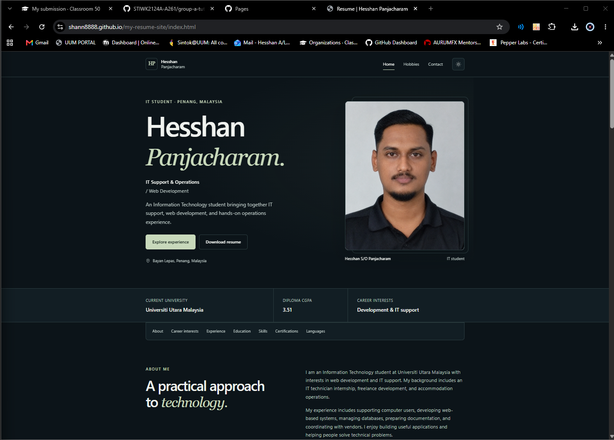
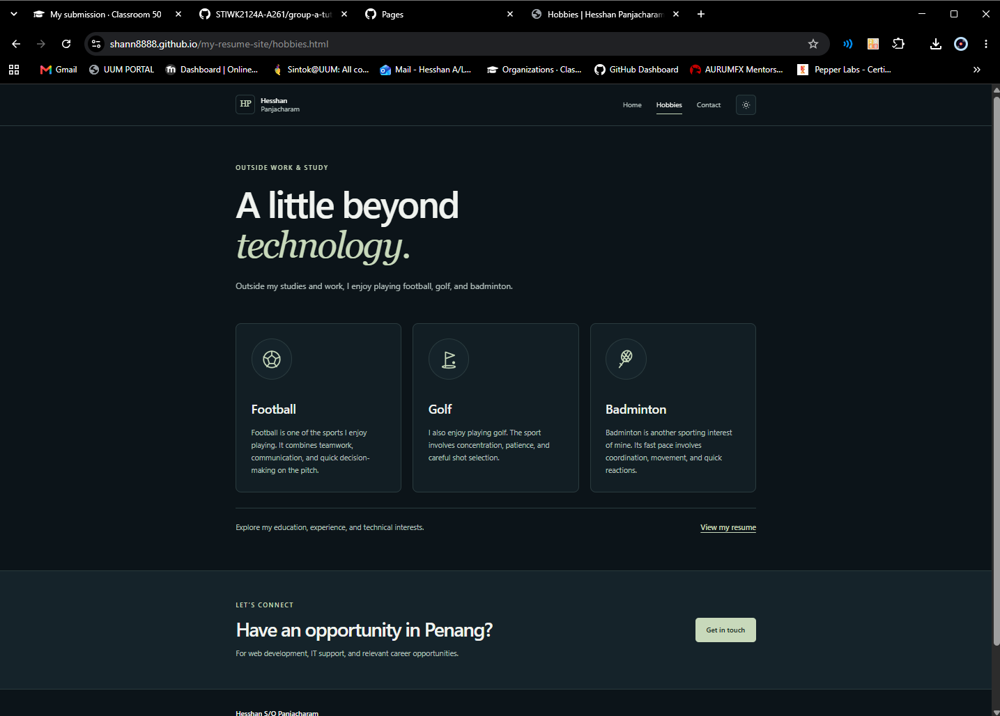
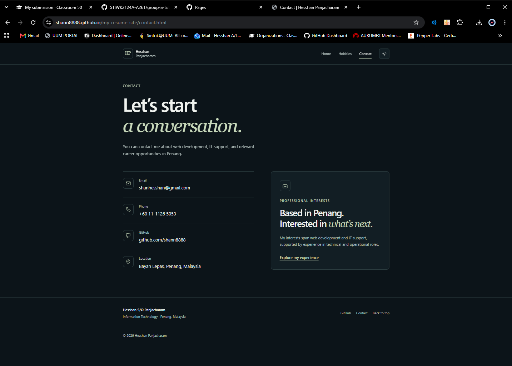

## Your Info:

Matric Number: 308688

Name: Hesshan Panjacharam

## Objective

Learn how to create and publish a simple personal website using basic HTML elements and GitHub Pages.

## Learning Outcomes

By the end of this tutorial, students should be able to:
1. Apply appropriate HTML tags to create a well-structured resume page.
1. Add images, hyperlinks, and lists to format web content effectively.
1. Create multiple linked web pages (e.g., Home, Hobbies, Contact).
1. Upload and manage files in a GitHub repository.
1. Publish their personal website using GitHub Pages and share it publicly.

## Instruction

1. Create _THREE (3)_ HTML pages (Home, Hobbies, Contact) for your `Resume` website.
2. Create `style.css` for styling the pages.
3. Create a new empty repo on GitHub (e.g., my-resume-site).
4. Use the Git command to upload your resume to GitHub

```
git init
git add .
git commit -m "Initial resume site"
git branch -M main
git remote add origin https://github.com/<yourusername>/my-resume-site.git
git push -u origin main
```

5. Publish with GitHub Pages
   - On GitHub: Settings → Pages
   - Source: “Deploy from a branch”
   - Branch: main · Folder: / (root) → Save
   - Wait a moment, then your site appears at

```
https://<yourusername>.github.io/my-resume-site/
```

## Submission

1. Add your Matric Number and Name.
2. Add your Resume link below.
3. Write the mistake in the git or GitHub instructions.

## What is the mistake?

The Git commands are valid when starting a new local repository and uploading it to an empty GitHub repository, after replacing `<yourusername>` with the actual username.

For my cloned GitHub Classroom repository, Git was already initialized and the `origin` remote already existed. Running `git init` again was unnecessary. Running `git remote add origin ...` again would produce `error: remote origin already exists`.

I kept `origin` connected to the Classroom repository and added a second remote named `website` for my new public repository. I pushed the `main` branch to both repositories and published the personal repository using GitHub Pages with `main` and `/ (root)`.

Reference: [Managing remote repositories — GitHub Docs](https://docs.github.com/en/get-started/git-basics/managing-remote-repositories).

## Link to your Resume

[View my published resume website](https://shann8888.github.io/my-resume-site/)

[Download my resume PDF](documents/resume.pdf)

[Public website repository](https://github.com/shann8888/my-resume-site)

## Link of YouTube References (at least five references)

Learning resources relevant to this project:

1. [HTML Crash Course For Absolute Beginners — Traversy Media](https://www.youtube.com/watch?v=UB1O30fR-EE) — HTML structure, headings, links, images, and lists.
2. [CSS Crash Course For Absolute Beginners — Traversy Media](https://www.youtube.com/watch?v=yfoY53QXEnI) — CSS selectors, spacing, colours, and layout.
3. [JavaScript Crash Course For Beginners — Traversy Media](https://www.youtube.com/watch?v=hdI2bqOjy3c) — JavaScript fundamentals relevant to interactive controls.
4. [Git and GitHub for Beginners - Crash Course — freeCodeCamp.org](https://www.youtube.com/watch?v=RGOj5yH7evk) — Version control, staging, commits, and pushing changes.
5. [How to put an HTML website online (on the Internet) — SuperSimpleDev](https://www.youtube.com/watch?v=p1QU3kLFPdg) — Publishing an HTML website using GitHub Pages.

## Website Overview

This website presents my resume, work experience, education, skills, certifications, languages, hobbies, and contact information.

| File | Purpose |
| --- | --- |
| `index.html` | Home and resume, including work experience and qualifications |
| `hobbies.html` | Football, golf, and badminton |
| `contact.html` | Email, phone, GitHub profile, and location |
| `style.css` | Shared styling, responsive layouts, and light and dark colours |
| `theme.js` | Theme switching, mobile navigation, and scroll animations |
| `images/profile.png` | Profile portrait |
| `documents/resume.pdf` | Downloadable resume |

The three pages share navigation and styling. The Home page includes section links that remain visible while scrolling. The website supports light and dark themes, saves the selected theme where browser storage is available, and respects reduced-motion preferences.

## Run Locally

Open the cloned repository in IntelliJ IDEA. Open its PowerShell terminal in the repository root and run:

```powershell
Start-Process .\index.html
```

The Home page opens in the default browser. Use the navigation links to open Hobbies and Contact. No dependency installation or build command is required.

## Published Website Screenshots

### Home

The Home page introduces my background and provides access to my work experience and downloadable resume.



### Hobbies

The Hobbies page presents football, golf, and badminton.



### Contact

The Contact page provides my contact details and GitHub profile link.



## Checks Completed

- Opened Home, Hobbies, and Contact on the published website.
- Checked navigation between the three pages.
- Checked light and dark theme switching.
- Downloaded and opened the updated resume PDF.
- Checked the responsive pages locally and confirmed there was no sideways page scrolling.

## Deployment

GitHub Pages publishes the public repository from the `main` branch and `/ (root)` folder.

The Classroom repository remains connected as `origin`. The public website repository is connected as `website`. After committing changes, upload them to both repositories from the project terminal:

```powershell
git push origin main
git push website main
```
